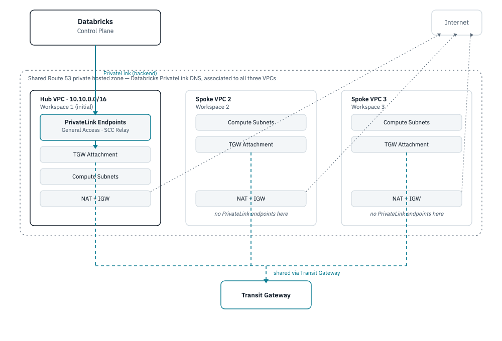

# Provisioning Additional Workspaces (Hub-and-Spoke PrivateLink)

How to add workspace 2, 3, etc. in their own VPCs, reusing workspace 1's
existing PrivateLink connection to the Databricks control plane instead of
building new endpoints for each one.



This assumes workspace 1 (`network/` + `databricks-sra/`) is already
applied — see [BUILD_PLAN.md](../BUILD_PLAN.md). Steps 3 and 4 below
(Transit Gateway, Route 53 association) aren't in this repo yet; this
document is the runbook for adding them, not a list of commands that
already work today.

## 1. Get the hub's registered PrivateLink endpoint IDs

Spoke workspaces reuse workspace 1's Databricks-side (MWS) VPC endpoint
registrations, not the raw AWS endpoint IDs. Pull them from the hub's
Terraform state:

```sh
cd databricks-sra
terraform state show 'module.databricks_mws_workspace.databricks_mws_vpc_endpoint.general_access[0]' | grep vpc_endpoint_id
terraform state show 'module.databricks_mws_workspace.databricks_mws_vpc_endpoint.scc_tunnel_dataplane_relay_access[0]' | grep vpc_endpoint_id
```

Note both `vpc_endpoint_id` values — they go into the spoke's tfvars in
step 5.

## 2. Create the spoke VPC

Copy `network/` to `network-spoke-2/` and apply it with a different
`resource_prefix` and non-overlapping `vpc_cidr` (e.g. `10.11.0.0/16`).

The spoke doesn't need its own PrivateLink endpoints to the Databricks
control plane — it'll reach the hub's instead. Comment out or remove the
`aws_vpc_endpoint.general_access` and `aws_vpc_endpoint.scc_relay`
resources (and the two `*_service_name` variables) in the copy before
applying, since step 4 is what actually connects it to the hub's
endpoints.

```sh
cd network-spoke-2
terraform init
terraform apply
terraform output   # note custom_vpc_id, custom_private_subnet_ids, custom_sg_id
```

## 3. Create the Transit Gateway (once, shared by all spokes)

Add this in a new `transit-gateway/` directory (or in `network/` itself,
since the hub VPC attaches to it too):

```hcl
resource "aws_ec2_transit_gateway" "this" {
  description = "dbx-trial PrivateLink sharing"
}

resource "aws_ec2_transit_gateway_vpc_attachment" "hub" {
  transit_gateway_id = aws_ec2_transit_gateway.this.id
  vpc_id              = module.hub.custom_vpc_id            # from network/ output
  subnet_ids           = module.hub.custom_private_subnet_ids
}
```

Each spoke gets its own `aws_ec2_transit_gateway_vpc_attachment`. Then,
in every VPC's private route table, add a route for the other VPCs' CIDRs
pointing at the Transit Gateway:

```hcl
resource "aws_route" "to_tgw" {
  route_table_id         = aws_route_table.private.id
  destination_cidr_block = "10.0.0.0/8"   # covers hub + all spoke CIDRs
  transit_gateway_id     = aws_ec2_transit_gateway.this.id
}
```

## 4. Share the Route 53 private hosted zone

The hub VPC's `general_access`/`scc_relay` interface endpoints created a
private hosted zone when `private_dns_enabled = true`. Associate it with
each spoke VPC so their clusters resolve the Databricks hostname to the
hub's endpoint ENIs:

```sh
aws route53 list-hosted-zones-by-vpc --vpc-id <hub-vpc-id> --vpc-region us-east-1
aws route53 associate-vpc-with-hosted-zone --hosted-zone-id <zone-id> \
  --vpc VPCRegion=us-east-1,VPCId=<spoke-vpc-id>
```

(Cross-account associations need an authorization step first via
`aws route53 create-vpc-association-authorization` — not needed here
since everything's in the same AWS account.)

## 5. Deploy the spoke workspace

Copy `databricks-sra/` to `databricks-sra-2/` (or use a Terraform
workspace: `terraform workspace new spoke-2`). Set its `terraform.tfvars`:

```hcl
resource_prefix = "dbx-trial-2"
custom_vpc_id                     = "<from step 2 output>"
custom_private_subnet_ids         = ["<from step 2 output>"]
custom_sg_id                      = "<from step 2 output>"
custom_general_access_mws_vpce_id = "<from step 1>"
custom_scc_relay_mws_vpce_id      = "<from step 1>"
```

Setting the `*_mws_vpce_id` variables (already declared in
[`databricks-sra/variables.tf`](../databricks-sra/variables.tf)) tells
Terraform to skip registering a new AWS endpoint with Databricks and wire
the hub's existing registration straight into this workspace's network
config.

```sh
cd databricks-sra-2
terraform init
terraform plan
terraform apply
```

## 6. Verify

- `terraform output workspace_host` → log in, confirm the workspace loads.
- Start a cluster in the spoke workspace; it should reach the control
  plane over the hub's PrivateLink connection, not the public internet.
- Confirm the spoke's NAT gateway still gives it independent internet
  egress for `pip install`, etc. — that part isn't shared.

Repeat steps 2–6 for each additional workspace, reusing the same Transit
Gateway and hosted-zone associations from step 3–4.
