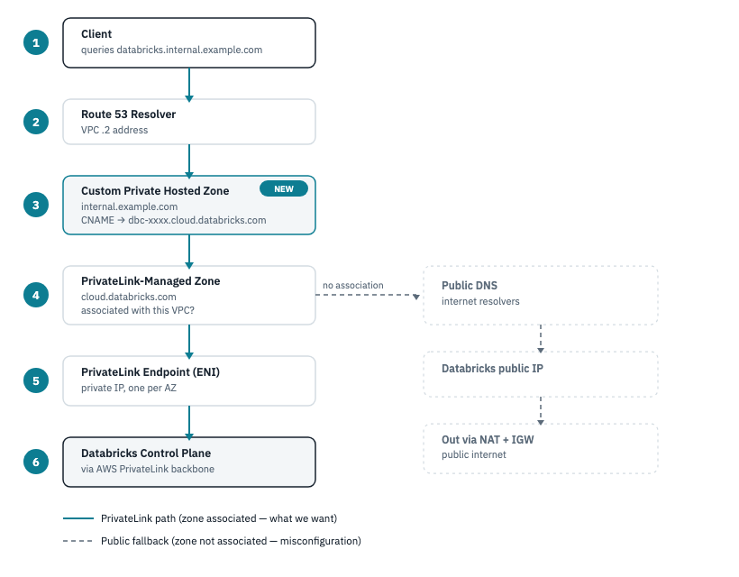

# Route 53 Custom DNS for the Databricks PrivateLink Endpoint

Design for adding a custom, friendly DNS name (e.g.
`databricks.internal.example.com`) that resolves privately to the
Databricks workspace's PrivateLink endpoint, instead of requiring internal
users and apps to reference the auto-generated
`dbc-xxxxxxxx-xxxx.cloud.databricks.com` hostname directly.



## 1. Why this matters

`network/main.tf` already sets `private_dns_enabled = true` on the
`general_access` interface endpoint. That makes AWS auto-manage a Route 53
private hosted zone for the *exact* Databricks hostname
(`cloud.databricks.com`), so clients resolving that hostname inside the VPC
get the endpoint's private IP instead of Databricks' public IP — traffic
stays on PrivateLink.

That's automatic, but it only resolves the literal workspace hostname. If
you want internal tooling to reference something shorter or
organization-branded — `databricks.internal.example.com` — that name
doesn't exist anywhere yet. This document adds it as a custom record in
the same private hosted zone, pointing at the real workspace hostname, so
it resolves through the same private path.

## 2. How resolution works today (no custom entry)

1. A client in the VPC queries `dbc-xxxxxxxx-xxxx.cloud.databricks.com`.
2. The query hits the VPC's Route 53 Resolver (the `.2` address in the
   VPC's CIDR).
3. The resolver checks hosted zones associated with the VPC. The
   PrivateLink-managed private hosted zone for `cloud.databricks.com` is
   associated here, and the queried name matches it.
4. The zone returns the PrivateLink endpoint's ENI private IP (one per AZ).
5. Traffic flows to that private IP, over the PrivateLink ENI, onto the
   AWS PrivateLink backbone to the Databricks control plane — never
   touching the public internet.

If the zone weren't associated with the VPC (or `private_dns_enabled` were
`false`), step 3 would fail to match, and the resolver would fall through
to public DNS — returning Databricks' public IP, and sending traffic out
through the VPC's NAT gateway instead.

## 3. Adding the custom entry

Add a `CNAME` record in the same private hosted zone, aliasing the custom
name to the real workspace hostname:

```hcl
data "aws_route53_zone" "databricks_private" {
  name         = "cloud.databricks.com"
  private_zone = true
  vpc_id       = module.network.custom_vpc_id   # or aws_vpc.this.id in network/
}

resource "aws_route53_record" "databricks_alias" {
  zone_id = data.aws_route53_zone.databricks_private.zone_id
  name    = "databricks.internal.example.com"
  type    = "CNAME"
  ttl     = 300
  records = ["dbc-xxxxxxxx-xxxx.cloud.databricks.com"]
}
```

Two things worth checking before applying this:

- **The custom name must live in a zone the VPC can actually query.** A
  `CNAME` added directly to the PrivateLink-managed zone works if that
  zone's apex matches your custom name's parent domain (it generally
  won't, since the managed zone is `cloud.databricks.com`, not
  `example.com`). More commonly, this record belongs in **your own**
  private hosted zone for `internal.example.com` (or `example.com`),
  associated with the same VPC — the `CNAME`'s target
  (`dbc-xxxxxxxx-xxxx.cloud.databricks.com`) still resolves through the
  PrivateLink-managed zone from step 2 above, since that resolution
  happens as a separate, second DNS lookup.
- **CNAME, not ALIAS, at a non-apex name.** Route 53 alias records only
  target AWS resources (ELB, CloudFront, other Route 53 records, etc.),
  not arbitrary external hostnames — a plain `CNAME` is correct here.

## 4. Sharing the custom entry across spoke VPCs

If you've followed
[multi-workspace-provisioning.md](multi-workspace-provisioning.md) to add
spoke workspaces, associate your custom zone with each spoke VPC the same
way the PrivateLink-managed zone gets shared:

```sh
aws route53 associate-vpc-with-hosted-zone \
  --hosted-zone-id <your-custom-zone-id> \
  --vpc VPCRegion=us-east-1,VPCId=<spoke-vpc-id>
```

Every VPC needs **both** zones associated to resolve the custom name
end-to-end: your custom zone (for the alias) and the PrivateLink-managed
zone (for the real hostname the alias points to).

## 5. Verify

From an instance or cluster inside the VPC:

```sh
dig databricks.internal.example.com
# should return a CNAME to dbc-xxxxxxxx-xxxx.cloud.databricks.com,
# which should itself resolve to a 10.x private IP, not a public one
```

If it resolves to a public IP, the hosted zone isn't associated with that
VPC, or `private_dns_enabled` is off on the endpoint — traffic will go out
through NAT instead of PrivateLink.
